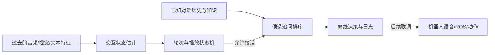

# 智能交互机器人毕业论文项目

**2026-09-15 更新：**创新点一已采用 MELD 准备“缺失模态下的对话情感状态估计”。数据下载、冻结特征、模型、消融和服务器脚本见 [创新点一_数据与训练.md](创新点一_数据与训练.md)。当前没有启动正式训练；MELD 不提供 HOLD/SHIFT 标签。

本分支按三个研究点组织：**多模态交互状态估计 → 知识增强追问排序 → 机器人本体交互验证**。前两个是可调整的方法原型，第三个保留已有机器人软件。当前优先在 Windows 上完成离线开发，服务器恢复后再开展正式训练。

先看 [开发与实验计划](docs/开发与实验计划.md)，再看 [数据与标注规范](docs/数据与标注规范.md)。专利与代码的对应情况见 [专利与现有成果对照](docs/专利与现有成果对照.md)。

## 现在能运行什么

- 无第三方依赖的状态规则基线、BM25 追问排序、数据校验、评测和离线回放。
- 两个可训练的 PyTorch 特征级原型，以及训练、验证集选模、保存检查点和评测命令。
- 真实 FQ-Bank 开发集的转换与审计工具；当前已运行一次清理版开发基线。
- 原机器人 ROS/语音/动作模块保留在 `robot_runtime/`，尚未与新模型进行硬件联调。

`data/examples/` 和 `make_smoke_features.py` 产生的样本是人工/随机示例，只用于软件验证。**它们的分数不能用于证明论文方法有效。** 神经模型当前接收已提取的特征，没有训练音视频编码器，也没有完成真实数据上的模型效果验证。

## 在这台 Windows 上开始

已建立独立的 `.venv`（Python 3.9），离线部分无需安装 ROS、CUDA 或调用付费 API：

```powershell
cd D:\PyCharm\毕业论文\yqy_audio_main
.\.venv\Scripts\python.exe -X utf8 -m unittest discover -s tests -v
.\.venv\Scripts\python.exe -X utf8 -m interview_robot replay
.\.venv\Scripts\python.exe -X utf8 -m interview_robot evaluate-ranking
.\.venv\Scripts\python.exe -X utf8 -m interview_robot evaluate-state
```

也可执行 `powershell -ExecutionPolicy Bypass -File scripts/dev.ps1 demo`；脚本只对当前进程生效，不修改系统策略。可选任务为 `test`、`demo`、`ranking`、`state`。

回放输出在 `outputs/trace.jsonl`，包含每一步状态、决策和执行阶段；不会发声或发送机器人指令。第一轮选择问题后等待播放反馈，播放结束后经过冷却窗口，才允许下一轮提问。

本机已有 `D:\Anaconda\envs\DL\python.exe`（Python 3.9.19、PyTorch 1.12.0），已用它完成 CPU 模型测试，无需现在改动显卡环境：

```powershell
& 'D:\Anaconda\envs\DL\python.exe' -X utf8 scripts/smoke_models.py
& 'D:\Anaconda\envs\DL\python.exe' -X utf8 -m unittest discover -s tests -v
```

## 数据和实验命令

官方开发集已下载到本地忽略目录 `data/raw/fq-bank/dev.json`。复现当前审计与基线：

```powershell
.\.venv\Scripts\python.exe -X utf8 -m interview_robot convert-fqbank --input data/raw/fq-bank/dev.json --split dev --output data/processed/fq-bank/dev.jsonl
.\.venv\Scripts\python.exe -X utf8 -m interview_robot validate-ranking data/processed/fq-bank/dev.jsonl
.\.venv\Scripts\python.exe -X utf8 -m interview_robot evaluate-ranking --data data/processed/fq-bank/dev.jsonl --output outputs/fqbank-dev-bm25.json
```

转换会去重同标签的完全相同候选，并隔离正负标签冲突的整条记录。完整审计保存在输出旁的 `.meta.json`。该协议改变了候选集合和样本数，不能直接与原论文表格比较；详见 [本次开发验证](docs/本次开发验证.md)。

特征级训练和检查点评测见 [服务器迁移与训练](docs/服务器迁移与训练.md)。所有路径通过命令行传入，模型内部没有 Windows 绝对路径。实验目录会记录数据 SHA256、配置、随机种子、Git 版本和工作区是否有未提交修改。

## 目录



```text
interview_robot/
  data.py             数据校验与划分检查
  datasets.py         FQ-Bank 转换
  state.py            因果规则基线
  ranking.py          文本排序基线
  runtime.py          回放状态机与旧动作协议适配
  models/             状态估计与知识排序模型原型
  train.py            特征级训练和检查点评测
  cli.py              统一命令行入口
robot_runtime/        已有机器人系统与硬件诊断
configs/              本地配置和可修改的模型配置
data/examples/        可公开的小型人工示例
docs/                 论文规划、标注、成果对照和验证记录
scripts/              Windows 入口与模型验证工具
tests/                数据、模型和交互边界测试
```

清理前基准为 `23144b8a751ee729b07264605c02360c6f820f82`。完整归档及移出文件位于仓库外的 `D:\PyCharm\毕业论文\备份`，清单见 [cleanup_manifest.json](docs/cleanup_manifest.json)。原始录音、模型、实验输出和凭据不纳入新代码目录的版本管理。
