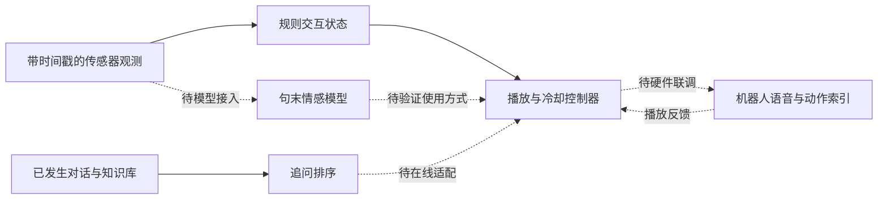

# 面向智能交互机器人的鲁棒多模态情感感知与知识增强追问方法研究

硕士学位论文工作草稿，2026-09-29。当前无正式训练和真人实验结果，以下用于建立论证结构、方法定义与实验设计，不是可直接提交的终稿。方法实现状态以代码审查记录为准；所有“待验证”均不能改写成已取得的成绩。

2026-10-08 扩写入口：[绪论与问题定义](论文_01_绪论与问题定义.md)、[实验协议与结果占位](论文_实验协议与结果占位.md)、[系统接口与闭环验证方案](论文_系统接口与闭环验证方案.md)。本稿保留方法公式；质量元数据压力评测入口本轮已实现，效果仍待正式训练后验证。

## 摘要草稿

智能交互机器人需要在信息不完整的条件下理解用户表达，并结合对话内容选择适宜的后续问题。现有系统的模块可独立获得较高的离线指标，但传感器缺失、质量估计偏差、候选问题采样方式及真实交互时序可能影响其实际表现。围绕这些问题，本课题研究句末多模态情感识别、知识增强追问选择及其在机器人交互系统中的应用。

在情感识别方面，课题采用文本、音频和视觉的冻结表示，研究缺失标记、信号质量代理与历史上下文的联合利用，并通过分类与概率可靠性指标分析退化行为。在追问选择方面，课题将已发生的对话、仅由历史检索的知识及候选问题作为输入，建立问题相关的双路融合与历史覆盖表示，并对候选来源捷径和负例难度进行独立诊断。在系统方面，课题基于已有机器人软件，将状态观测、追问选择和播放反馈组织为可追溯的交互流程。

【待填：正式数据协议、与强基线的比较结果、三种子波动、真人实验结论及局限。当前不写“显著优于”“提高百分之几”或“达到先进水平”。】

关键词：智能交互机器人；多模态情感识别；缺失模态；追问排序；知识增强。

## 第一章 绪论

### 1.1 研究背景与问题

机器人访谈和导览等交互任务不仅要求系统回答问题，也要求其理解刚发生的对话并组织后续交流。实际设备采集的音视频可能缺失或退化；对话系统接收到的状态也可能不及时或不可靠。如果系统将低质量线索等同于可靠证据，错误的情绪判断可能影响交互反馈。如果追问仅依赖表面词汇相似度，则可能重复已回答的内容，或者将同领域但与当前语境无关的问题排在前面。

这些问题不能仅通过提高单一数据集上的平均分解决。情感识别需要区分可用信息与不确定信息，追问选择需要区分主题相关、已经讨论和能够继续探究的内容，系统则需要明确模型建议与实际动作之间的执行条件。因此，本课题采用模块化研究与闭环验证结合的路线，分别分析感知、追问和执行中的约束，再在真实机器人上验证其组合表现。

### 1.2 研究范围

第一部分预测的是**当前完整话语结束后的表达情绪/情感**，并不预测话语中途的轮次结束。第二部分研究**固定候选集合中的追问重排**，暂不将开放域问题生成或全库检索作为已完成能力。第三部分研究**高层交互控制与动作索引执行**，不声称实现底层运动轨迹规划。三个边界分别由可用标签、代码输入和设备接口决定。

### 1.3 拟研究内容

（1）不完整多模态输入下的情感感知及概率可靠性；（2）考虑历史覆盖与知识条件的多轮追问选择；（3）面向机器人播放与动作反馈的交互系统实现和验证。最终贡献句应在实验完成后，根据真实证据改写。现阶段不能将三个章节直接等同于三个已验证原创算法。

## 第二章 相关技术与研究协议

相关工作见 [论文相关工作与创新边界](论文相关工作与创新边界.md)。正文应围绕任务差异和可比条件组织，而不是按年份罗列模型名称。

### 2.1 统一记号

| 记号 | 含义 |
| --- | --- |
| t | 已完成话语或离散交互步骤索引，不等同于真实时间戳 |
| x(t,m) | 第 t 句的第 m 个模态表示 |
| a(t,m), q(t,m), d(t,m) | 可用标记、质量代理、特征年龄 |
| H(t) | 截至决策时刻已经发生的历史 |
| K(t)=Retrieve(H(t),B) | 从固定知识库 B 仅根据历史检索的知识 |
| C(t) | 固定候选问题集合 |
| r(t,j), s(t,j) | 候选相关性标签及预测分数 |

知识库中的客观事实可以事先存在，即使它与未来对话内容相同，也不自动构成泄漏；真正的约束是检索查询和选择过程不得读取未来答案或目标 attrs。候选集合中的参考问题由离线基准构造提供，因此该实验不测开放式候选召回能力。

### 2.2 数据划分与复现

MELD 使用既有场景去重协议；FQ-Bank 保留官方划分并排除冲突样本/重叠对话；KdConv 改造成独立命名的弱监督追问数据。所有归一化统计只拟合训练数据。模型与阈值只由 dev 决定，test 在协议冻结后使用。保存代码、原始数据、处理索引、模型与特征配置的校验和。

## 第三章 不完整多模态输入下的情感感知

### 3.1 输入与预测时刻

当前文本来自已完成话语，语音和视频来自对应片段。冻结编码器分别得到 768/768/512 维表示，只有当前句和此前同一对话的句子进入窗口。使用完整片段编码只对句末任务成立，不能用于声称片段结束前的接话预测。

视觉编码目前是采样全帧 ResNet18，可能包含多个角色与场景背景；它不等价于已完成说话人跟踪和人脸表情定位。这是特征层面的主要限制，应在方法与失败分析中说明。

### 3.2 当前已实现模型

先对每个模态线性投影，令 z(t,m)=W(m)x(t,m)+b(m)。门控计算为：

```text
g(t,m) = a(t,m) · q(t,m) · exp(-d(t,m))
         · sigmoid(w(m)^T [z(t,m); q(t,m); d(t,m)] + c(m))
z'(t,m) = g(t,m) · z(t,m)
```

模态注意力融合有效表示，并加入空模态 token 以处理全部缺失的数值情况；随后用单向 GRU 聚合句序列，最后一个有效位置输出 emotion 和 affect 分类结果。全部缺失时模型仍可输出先验式分布，“数值有限”不意味着具有识别依据。

当前损失为训练频率平方根倒数加权的情绪交叉熵，加上权重 0.3 的情感交叉熵。两个任务标签均来自官方数据，不能把 emotion 简单映射成 affect。训练时进行模态 dropout；预测时关闭随机 dropout，并使用固定缺失掩码比较模型。

q 是信号代理而非概率；d 在现有 MELD 缓存中恒为零。论文现阶段最多分析质量代理和缺失处理，不能声称证明了特征年龄衰减有效。新增概率指标也不改变这个事实。

### 3.3 待检验的改进方向

质量代理可能在语义上失准：对比度高的画面未必包含目标表情，响亮音频未必清晰。建议先对 q 做恒定、打乱和失准压力测试，再决定是否引入学习式可靠性或保守融合。若引入额外监督，必须来自 train 内可用目标；不使用测试正确性训练质量头。

概率可靠性使用 NLL、多分类 Brier（按类别误差平方求和后对样本平均）、10 等宽置信区间 ECE、风险—覆盖曲线。相同置信度样本整体保留，报告实际覆盖率。测试曲线是描述性结果；部署拒识阈值须在独立校准集/验证集选择，不能反过来用 test 曲线调阈值。相关基础见 [Guo et al., 2017](https://proceedings.mlr.press/v70/guo17a.html)。

### 3.4 实验表占位

| 方法/条件 | 干净 Macro-F1 | 缺文本 Macro-F1 | 随机缺失 Macro-F1 | NLL/ECE | 延迟 |
| --- | --- | --- | --- | --- | --- |
| 文本单模态 | 待训练 | 待评估 | 待评估 | 待评估 | 待实测 |
| 简单拼接 | 待训练 | 待评估 | 待评估 | 待评估 | 待实测 |
| 当前融合原型及消融 | 待训练 | 待评估 | 待评估 | 待评估 | 待实测 |
| 公平配置的强相关方法 | 待选定/复现 | 待评估 | 待评估 | 待评估 | 待实测 |

## 第四章 知识增强的多轮追问选择

### 4.1 任务定义与候选协议

给定 H、K 和 C，对每个候选 q(j) 输出分数 s(j)，目标是将被标注为适宜追问的候选排前。FQ-Bank 使用官方候选标签；KdConv 只有观察到的下一问，因此将其作为弱正例，其他对话中采样的问题作为弱负例。二者的标签可靠性不同，结果不能合并为一个总分。

KdConv v2 中，train/dev/test 各自使用本划分、本领域、其他完整对话的观察问题构造候选。train 更新参数时只能读取 train；dev/test 的候选池只定义离线评价题目，不进入训练，也不进入知识检索。此举修正 v1 中正负候选来自不同分布的明显捷径，但不能保证消除所有统计偏差。另设纯随机负例协议检验难负例构造敏感性。

### 4.2 历史限定知识与表示

使用历史文本中的实体检索固定 KdConv 知识库，将三元组按最近四句历史的词汇相关度取最多八条。没有命中时保留空知识，不从目标回答补齐。FQ-Bank 默认无外部知识，只用于文本追问能力基准。

冻结编码器分别表示最近八句历史、知识条目和候选。历史投影后加入相对最近句的正弦位置编码：最新有效句的位置为零，补齐位置不计入句序。知识集合不加入历史时序位置。位置编码是标准组件，用于纠正原型对历史重排不敏感的问题，不单独作为算法创新。

### 4.3 双路融合与覆盖特征

```text
d(j) = Attention(q(j), H, H)
k(j) = Attention(q(j), K, K)
alpha(j) = sigmoid(Wg [q(j); d(j); k(j)] + bg)
u(j) = alpha(j) · d(j) + (1-alpha(j)) · k(j)
s(j) = MLP([q(j); u(j)]) + CoverageMLP(phi(j))
```

空知识时 alpha 强制为一；history、fixed、gated、coverage 四组分别控制知识、可学习门控和辅助特征。phi 的四维为历史单句最大词汇重叠、历史词覆盖比例、知识最大重叠和知识存在标记。所有神经/覆盖分支统一最近八句历史，避免消融组额外读取更长历史。

上述 phi 只是代理，无法精确表示“已经回答”和“新的信息需求”。若希望形成更强的方法贡献，应在人工标注支持下研究语义覆盖和知识可靠性，而不是将词汇重叠改名为信息增益。额外模块是否保留由消融决定。

### 4.4 优化目标与公平对照

对候选相关性 r(j) 定义 gain(j)=2^r(j)-1，目标分布 y(j)=gain(j)/sum gain。listwise loss 为 -sum y(j) log softmax(s)(j)。补齐候选不进入 softmax；允许多正例标签。KdConv 弱负例并不保证是真负例，因此该目标只是当前可操作的近似监督。

正式比较至少需要随机期望、BM25、冻结语义模型和可微调 Cross-Encoder。Cross-Encoder 的必要性来自 [FQ-Bank 原论文](https://aclanthology.org/2023.findings-eacl.149/) 已采用监督 BERT/RoBERTa 排序；2026-10-08 已补本项目的 Cross-Encoder 入口并完成中英文前向检查，尚未训练，不声称复现原论文表格。比较必须使用相同候选、历史可见范围、训练划分和选模标准；不同 token/计算预算单独报告。

### 4.5 实验与统计设计

主指标 MRR，辅助 Recall@1/3 与 nDCG@1/3；知识条件包含原始、缺失、来自不同对话的打乱知识。打乱知识仍可能相关，不能称为已构造错误事实。通过人工多维审计另报重复性、合理性和可回答性。

三种子分别训练；报告均值与样本标准差。对给定两个模型，以完整对话为簇进行配对 bootstrap，计算原始“轮次加权”指标之差，避免把同一对话的多个样本视为独立。不同方法必须对应完全相同的样本/候选 ID，缺样本则失败，不能静默求交集。区间不是多重比较校正，也不能替代训练种子波动。

本轮无训练诊断揭示：候选协议改变时，BM25 dev MRR 会发生明显变化；这首先说明负例构造决定任务难度，不说明算法进步。正式结果表应同时注明 mixed/random 协议和训练/评测是否跨协议。

## 第五章 机器人交互系统设计与验证

### 5.1 已有系统与新增模块

已有软件包括图像输入、实时语音客户端、音频播放管理和动作索引接收。新增研究模块目前离线运行：情感估计输出、追问排序分数不能自动等同于机器人已成功说出问题或执行动作。论文中的结构图应使用实线标注已连接路径、虚线标注待接入路径。



### 5.2 时序与故障实验

控制器在处理阶段禁止重复提问，播放中等待，播放结束后进入冷却。新增独立确认式控制器按请求ID处理重复/乱序反馈，开始或结束确认超时后进入故障态，保留人工确认停止后的恢复记录，不自动重发。此接口尚未连接真实播放器，旧控制器保持兼容。系统故障回放可以验证逻辑性质，不能证明真实麦克风回声消除或 ROS 网络延迟。

建议日志至少记录：session_id、utterance_id、输入观测时间、推理开始/结束、候选/知识版本、所选问题、请求 id、播放开始/结束确认、动作索引、超时与恢复事件。所有延迟用同一单调时钟或明确时钟同步协议计算。

### 5.3 人机实验设计

先做设备试点估计延迟与故障范围，再决定正式参与者数和条件。对规则系统、单模块和完整系统进行顺序平衡，按参与者/会话分组，报告响应延迟、重复问题率、意外插话、任务完成情况以及相关性、自然度、交流负担评分。具体人数和统计功效尚未确定，不能预写“用户满意度显著提高”。

## 第六章 总结与展望占位

本章最终只能总结实际完成的工作及其证据范围。若缺模态鲁棒性改善但干净条件下降，应如实分析权衡；若知识方法只在某类负例上有效，应明确候选分布限制；若硬件实验未完成，不能把离线回放写成实机验证。

预留局限：影视与中文机器人场景差异、质量代理失准、视觉主体未定位、弱标签不完整、固定候选含正例、知识库覆盖限制、系统人工恢复依赖。后续方向必须从这些局限出发，而不是简单罗列更大模型。

## 写作待办

- 与导师确认题目、前两点可接受的研究贡献和系统章节定位。
- 补正式参考文献库与学校排版模板；当前为 Markdown 草稿。
- 完成强基线和人工试标后冻结最终方法定义，删掉无效机制。
- 服务器实验结束后再填写结果、置信区间、错误案例和结论。
