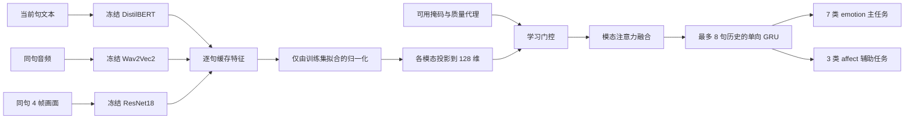

# 创新点一：数据选择、模型与服务器实验说明

**2026-09-29 补充：**评估器新增 NLL、多分类 Brier、ECE 和风险—覆盖曲线，尚未训练或校准模型。质量指标仍是启发式代理，age 仍恒零，全帧视觉不等于说话人表情定位。当前研究问题与剩余强基线工作见 [硕士论文研究与迭代规划](docs/硕士论文研究与迭代规划.md)。

更新时间：2026-09-15。对应 `biyelunwen` 分支。本文是第一点当前实施方案；此前《开发与实验计划》中“先寻找 HOLD/SHIFT 数据”的安排以本文的收敛方案为准。

## 1. 现在选哪个数据集

**先用 MELD 作为主数据集，不需要完全自建。第一点暂定为“面向不完整多模态输入的对话情感状态估计”。** 先验证情绪理解与缺失模态鲁棒性，再用机器人采集的小规模中文数据验证迁移效果。

MELD 来自《Friends》中的多人对话，同一句话具有文本、音频、视频，提供 7 类 emotion 和 3 类 sentiment。原始媒体是一句一个 MP4，音频直接从对应 MP4 解码，不能把不相关的声音和图片拼成一条样本。

| 候选 | 能研究什么 | 本项目安排 |
| --- | --- | --- |
| **MELD** | 对话历史、文本/语音/画面融合、情绪与情感分类 | 本轮主数据；下载原始媒体及官方三份标注 |
| IEMOCAP | 双人交互中的音视频情绪识别 | 可作为后续第二数据集；按官网申请取得数据后再适配，本轮未下载 |
| CH-SIMS / CH-SIMS v2 | 中文多模态情感、单模态与融合标签差异 | 后续中文扩展的优先候选；片段级标签不能直接替代连续对话历史，本轮未下载 |
| VAP 及其相关语料 | 语音活动与轮次预测 | 是另一种任务；官方训练说明涉及 Switchboard/Fisher/Candor 访问，当前不作为这套实验的前置条件 |
| 少量真实机器人采访 | 中文域迁移、摄像头遮挡、麦克风丢失、实际系统效果 | 后续补充；不必重建一个上万条的主训练集 |

来源：[MELD 官方页](https://affective-meld.github.io/)、[MELD 作者仓库](https://github.com/declare-lab/MELD)、[IEMOCAP 官网](https://sail.usc.edu/iemocap/)、[CH-SIMS 论文](https://aclanthology.org/2020.acl-main.343/)、[CH-SIMS v2 论文](https://arxiv.org/abs/2209.02604)、[VAP 作者实现](https://github.com/ErikEkstedt/VoiceActivityProjection)。本轮下载源为 MELD 官方页列出的作者 Hugging Face 仓库；没有采用来源不明的数据转载。

## 2. 第一、二、三点怎么衔接

第一点回答：**对方刚完成的这句话，结合已经发生的对话，现在表现出什么情绪/情感？缺少某个传感器时还能否稳定判断？**

第二点仍回答：结合对话历史和可检索知识，下一句追问选哪一个。当前 MELD 准备工作属于第一点，不是 FQ-Bank 排序训练，也没有给 MELD 自动生成追问标签。

第三点是机器人软件与本体集成。第一点未来输出的情感状态可作为交互反馈信息；什么时候播放、如何避免抢话和重复动作，仍由系统状态机与实际设备实验验证。

**MELD 不提供 HOLD/SHIFT、接话意愿、说话人定位、机器人动作等真值。** 不根据标点、情绪或“下一句换人”伪造接话标签。本次正式模型只创建 `emotion`、`affect` 两个头；原通用状态模型的 turn 等默认头仍可用于其他确有标签的数据，但不会混入 MELD 训练。

这里的情绪是数据集对表达的标注，不能等同于对人的真实内心状态作可靠判断。模型尚未训练，也尚未接入机器人在线推理。

## 3. 数据在哪里、数量是什么

仓库根目录：`D:\PyCharm\毕业论文\yqy_audio_main`。

```text
data/raw/meld/
  train_sent_emo.csv              官方训练标注
  dev_sent_emo.csv                官方验证标注
  test_sent_emo.csv               官方测试标注
  UPSTREAM_README.md              作者的数据格式说明
  UPSTREAM_LICENSE                作者仓库许可文本
  MELD.Raw.tar.gz                 完整原始媒体归档
  MELD.Raw.tar.gz.download.json   下载源、大小、SHA256
  download_manifest.json          全部下载清单
  extracted/                     解压后的内层压缩包和 MP4
data/processed/meld/
  train.jsonl / dev.jsonl / test.jsonl
  audit.json                     类别分布、缺失媒体、时间戳与重复审计
  protocol.json                  正式实验排除哪些重复场景
models/pretrained/meld/
  distilbert-base-uncased/
  wav2vec2-base-960h/
  resnet18-f37072fd.pth
  manifest.json                  编码器来源、版本、文件校验值
data/features/meld-v1/            服务器生成的正式特征缓存
outputs/meld/                    训练计划、检查、检查点及评估报告
```

| 划分 | 官方句数 | 实际 CSV 中对话数 | 默认去重实验句数 | 用途 |
| --- | ---: | ---: | ---: | --- |
| train | 9,989 | 1,038 | **9,977** | 拟合归一化、计算类别权重、更新模型 |
| dev | 1,109 | 114 | **1,109** | 选择模型与超参数、早停 |
| test | 2,610 | 280 | **2,610** | 方案确定后报告最终结果 |

完整原始包为 **10,878,146,150 字节**（约 10.88 GB / 10.13 GiB），固定版本 `9abc51ee7903424ffb971297608aa6d3d0de3bfa`。

官方文件 SHA256：

```text
a56b4407d574195cbce470d86f9c9d72fcfea59b0e34502ecd4babee4a5c613e
```

三份 CSV 同样固定了作者仓库提交 `e8cedf27b5d2877e198332c957127e16eb214afe` 和各自校验值，避免以后重新下载时悄悄切换数据版本。

下载脚本支持分段续传，并在完整校验通过后才生成最终文件名。`.part`、`.parts`、`.assembling` 代表下载过程中间文件，不代表完整数据已经可用。下载状态与本轮实际验证结果见 `docs/创新点一准备验证.md`。

固定官方归档存在两个已知媒体缺陷：开发集 `meld:dev:110:7` 没有 MP4；训练集 `meld:train:125:3` 的 MP4 无有效 `moov` 信息、无法解码。两条样本都保留文本与标签，音频和视觉按真实缺失处理；正式报告须计入失败数，不能补造媒体。归档还带有一些 CSV 未引用的额外 MP4，特征索引只采用能由标注 ID 精确匹配的文件。

解压时同时保留外层包、内层包、MP4，续传块也会占空间。建议预留 **50 GB 以上**，缓存与实验输出另计。本机 D 盘本轮开始时约有 608 GB 可用。数据、模型、输出和虚拟环境都已经加入 Git 忽略，迁移时必须额外复制，不能指望只 `git clone` 就有这些大文件。

### 为什么不直接使用作者提供的特征包

作者部分音频特征做过有监督筛选，部分文本/音频表示来自双向上下文网络。本项目要明确限制可见历史，并比较新的缺失模态融合方法，因此从原始 MP4 和文本重新提取冻结特征。作者旧特征不能直接当作本项目未经标签训练、仅使用过去信息的输入。

### 为什么训练集少了 12 句

审计发现 `train` 的对话 12 与 `test` 的对话 85 来自同一集、同一时间段，且存在相同或高度相似的台词。默认 `meld-scene-dedup-v1` 协议排除整个训练对话 12，避免其作为当前句或历史进入训练。

官方 JSONL 保持完整，排除名单写在独立 `protocol.json`，便于回查。短句“Hey”“I’m sorry”在不同集里重复，不足以证明泄漏，因此没有据此删除其他对话。只看相同时间戳也不够，因为标注本身存在异常。

这是基于场景时间和文本的确定性审计，不保证发现了所有视频近重复。MELD 划分仍有同演员、同剧集，不是陌生参与者划分；因此默认结果须标明去重协议，不能直接冒充作者官方原始划分的复现成绩。

## 4. 每条样本如何组织

标注转换后，每句有独立 `id`，同一对话有 `group_id`，保存对应媒体路径、原文本、时间戳、真实标签和允许使用的 `past_ids`。

正式特征缓存中，每句一个 `.npz`：

| 字段 | 形状 | 说明 |
| --- | --- | --- |
| text | `[768]` | 冻结 DistilBERT 的句内 token 平均表示 |
| audio | `[768]` | 冻结 Wav2Vec2 的声学表示 |
| visual | `[512]` | 冻结 ResNet18 的画面表示 |
| available | `[3]` | 文本、音频、视觉是否实际可用 |
| confidence | `[3]` | 当前是启发式信号质量代理，范围 0–1 |
| age | `[3]` | 当前句末离线协议固定为 0 |

标签存在索引 JSONL 中，不拼进特征。说话人姓名、剧集号只用于元数据审计，不作为模型输入。每个缓存文件记录校验值，`provenance.json` 记录编码器与数据版本。

类别顺序固定：

```text
emotion: 0 neutral, 1 surprise, 2 fear, 3 sadness, 4 joy, 5 disgust, 6 anger
affect:  0 positive, 1 neutral, 2 negative
```

`affect` 直接读取官方 `Sentiment` 列，不自行把 surprise 等情绪强行映射为正面或负面。

### 预测时刻与历史范围

预测发生在**当前整句话结束并完成编码之后**。使用当前句加最多 7 句已结束历史，窗口最长 8 句；只使用同一对话。如果之前编号的句子与当前句重叠、且结束得更晚，则不放入当前历史。

编码器可在当前完整句内部使用双向信息，因为预测时当前整句已经可用；不允许读取下一句话。最终转写是官方人工文本，所以这是理想转写条件下的句末实验，不能声称已经实现在线 ASR 条件下的提前接话预测。

### 质量代理的含义

- 文本：保留下来的 token 比例，最多 128 tokens；不是 ASR 置信度。
- 音频：能量与波形削波比例的简单质量代理；不是情绪分类概率。
- 视觉：画面对比度和成功解码帧比例；不是人脸置信度。
- 缺失模态：掩码为 false、输入置零，门控不使用其内容。

这些代理只是待检验假设，不能写成已经校准的“可信度”。`uniform_quality` 消融会把可用模态质量都设为 1；若其表现不差于当前方案，应改进或删掉不成立的质量设计。`age=0` 意味着这一版没有验证异步传感器时间衰减的收益。

## 5. 训练的模型具体是什么



完整融合模型默认有 **429,459 个参数**，不含冻结编码器。冻结编码器版本写在 `configs/meld_features.json`，权重下载后按本地路径加载，不在每次训练时自动更新模型：

- [DistilBERT](https://huggingface.co/distilbert/distilbert-base-uncased)：英文预训练文本编码器，768 维。
- [Wav2Vec2 base 960h](https://huggingface.co/facebook/wav2vec2-base-960h)：16 kHz 单声道，取隐藏表示，不使用 ASR 分类输出；长音频按 8 秒切块，按块长度加权池化，包含整句。
- [ResNet18 ImageNet 权重](https://docs.pytorch.org/vision/0.20/models/generated/torchvision.models.resnet18.html)：每句按时长等间距取 4 帧，去分类头后平均。当前是**整幅画面特征**，尚无人脸跟踪和目标说话人定位，不能称为说话者表情专用编码器。

正式训练只更新小型投影、门控、融合、GRU 和分类头，冻结的三个编码器不参与反向传播。这样编码成本只支付一次，各个消融共享缓存，适合先在服务器完成可控实验。

损失为：`加权 CE(emotion) + 0.3 × 加权 CE(affect)`。每类权重按保留训练集的频数平方根倒数计算，再按类别平均归一化；验证和测试不参与拟合。训练集含大量 neutral，主结果不能只看 accuracy。

默认参数：hidden=128，4 个注意力头，窗口=8，batch=32，AdamW 学习率 3e-4，weight decay=0.01，最大 30 epoch，7 轮验证无提升早停，梯度裁剪 1.0，训练时模态丢弃概率 0.2。参数都在 `configs/meld_train.json`。

保存 `best.pt`、`normalization.json`、`config.json`、`report.json`，按验证集 **emotion Macro-F1** 选择最好模型。训练函数不打开测试特征。当前保存最佳检查点，不提供精确的中断续训；中断后保留旧目录，另建输出目录重新训练，避免把不同运行混成一次实验。

## 6. 实验怎么安排

### 6.1 先完成 9 个结构/训练对照

| 参数 `--variant` | 作用 |
| --- | --- |
| full | 门控 + 模态注意力 + GRU + 模态丢弃 + 质量代理 |
| text_only | 只输入文本，保留历史 GRU |
| audio_only | 只输入音频，保留历史 GRU |
| visual_only | 只输入画面，保留历史 GRU |
| concat_mlp | 各模态投影后拼接，加可用标记，经 MLP 分类，不使用历史 GRU |
| no_gate | 去掉质量门控，保留注意力、历史和模态丢弃 |
| no_temporal | 不使用 GRU，仅预测当前句 |
| no_dropout | 训练时不随机丢弃模态 |
| uniform_quality | 保留学习门控，所有可用模态的质量输入都设为 1 |

每个配置运行种子 42、2026、3407，共 27 次；先跑少数基线和一个种子检查真实曲线，再决定是否执行完整矩阵。单模态、MLP 与完整模型的容量不同，要报告参数量，不能把所有差别都归因为某一个机制。

### 6.2 每个选定检查点测试 8 个输入条件

干净输入、缺文本、缺音频、缺视觉、每个句子-模态独立缺失概率 0.1/0.3/0.5、全部模态缺失。相同样本的缺失掩码由其 ID 与固定扰动种子决定，在不同模型、批次、历史窗口中一致。测试时关闭训练的随机模态丢弃。

全部缺失是诊断条件，不作为主要性能主张。当前代码测试的是**模态缺失**，没有把特征置零包装成真实语音噪声、ASR 错误或遮挡实验。后续若做原始媒体加噪，要冻结加噪协议，重新提取特征，并保留真实的质量变化。

### 6.3 看哪些结果

主指标：7 类 emotion Macro-F1；同时报告 weighted-F1、accuracy、每类 precision/recall/F1、混淆矩阵。3 类 affect 同样单独报告。统计三个训练种子的均值和样本标准差，不把一个 seed 的结果写成稳定提升。

还要看缺失文本时跌幅、少数类 fear/disgust、不同质量分段和错误例子。训练日志记录耗时与模型参数量；这些不能直接当成机器人端的实际响应延迟，整机延迟应单独计时。

“加入门控、GRU、模态丢弃”本身不自动构成学术创新。已有 [MMIN](https://aclanthology.org/2021.acl-long.203/) 和 [MM-Align](https://aclanthology.org/2022.emnlp-main.717/) 等缺失模态研究。当前代码提供可复现的主线和基础对照；正式论文还应选取至少一个相关公开方法，在相同特征、划分与缺失协议下复现比较，不能把其他论文不同协议的表格数值直接搬过来。方法创新名称应根据真实实验与文献对比继续收敛。

## 7. 本机现在可以执行什么

下载、转换只需现有轻量 Python，不需要 GPU：

```powershell
cd D:\PyCharm\毕业论文\yqy_audio_main
.\.venv\Scripts\python.exe scripts\prepare_meld.py download --media
.\.venv\Scripts\python.exe scripts\prepare_meld.py extract
.\.venv\Scripts\python.exe scripts\prepare_meld.py prepare --require-media
.\.venv\Scripts\python.exe scripts\meld_features.py download-models
```

上述命令均不训练；已完成的数据会校验并复用，断线可重跑下载。若下载程序正在运行，不要对同一目录再启动第二个下载进程。

本机额外建立了 `.venv-meld` 用于开发验证，继承现有 DL 环境的 torch 1.12/torchvision 0.13，新增 Transformers 4.44.2 等工具。没有改原环境、驱动或启动正式训练。Linux 服务器须新建独立环境，不能复制 Windows 虚拟环境继续使用。

```powershell
# 仅运行数据与前向测试，没有优化器更新
.\.venv-meld\Scripts\python.exe -m unittest discover -s tests -p test_meld.py -v
# 只生成计划
.\.venv-meld\Scripts\python.exe scripts\run_meld_experiments.py --phase plan
```

## 8. 服务器恢复后如何启动

复制仓库代码，同时复制 `data/raw/meld` 和 `models/pretrained/meld`。为节省传输，已有完整归档时可只传 `MELD.Raw.tar.gz`、CSV、上游说明和下载清单，在服务器重新解压；不用传 `.parts`、`.part`、`.assembling` 或任何 Windows 虚拟环境。代码里默认使用相对目录，所以服务器无需创建 D 盘同名路径。

### 8.1 建环境

建议 Linux + Python 3.10/3.11。参考安装组合是 torch 2.5.1 / torchvision 0.20.1 / CUDA 12.1 wheel，其对应命令可在 [PyTorch 官方历史版本页](https://pytorch.org/get-started/previous-versions/) 核对。先在服务器用 `nvidia-smi` 查看实际驱动，再选择适配 wheel；脚本不安装显卡驱动。

```bash
cd /你的服务器路径/yqy_audio_main
bash scripts/meld_server.sh setup
source .venv-meld-server/bin/activate
```

需要其他官方 wheel 源时通过 `TORCH_INDEX_URL` 设置。例如仅验证 CPU 环境可选择 `https://download.pytorch.org/whl/cpu`；之后提特征、训练命令应显式指定 `--device cpu`，不能使用写着 cuda 的快捷阶段。

### 8.2 推荐先分阶段执行

```bash
# 下载/复用归档，解压，核对媒体，准备固定编码器；不训练
bash scripts/meld_server.sh prepare

# 提取完整 train/dev/test 特征；冻结编码器，不训练
bash scripts/meld_server.sh features

# 检查缓存完整性并执行一次无梯度前向；不训练
bash scripts/meld_server.sh check

# 服务器上明确开始训练
bash scripts/meld_server.sh train full 42
```

完成环境安装后，也可用 `bash scripts/meld_server.sh run full 42` 串行执行准备、特征、检查和训练。**本轮没有执行 train/run 阶段。**

特征提取支持逐句复用已有缓存；失败会记录到 `*.extraction.json`，不会用随机向量伪装成功。修复媒体问题后，可运行 `python scripts/meld_features.py extract --device cuda --retry-failed`。若某个划分超过 1% 的样本提取失败，正式训练会拒绝开始；先检查原因，不应直接放宽阈值。

全量提取需要多少时间取决于服务器、磁盘和编码器速度，当前未给出实测时长。冻结特征训练的显存需求比端到端微调小很多，但仍应先观察真实运行再调整 batch。

### 8.3 消融、评估与汇总

```bash
# 先查看命令，不执行
python scripts/run_meld_experiments.py --phase plan

# 确认准备完毕后，在服务器运行；已有非空输出目录会被保留并报错
python scripts/run_meld_experiments.py --phase train --variants full text_only concat_mlp --seeds 42

# 完整 27 次训练：建议先检查前面的基线再运行
python scripts/run_meld_experiments.py --phase train

# 在方法与超参数固定后评估测试集
python scripts/run_meld_experiments.py --phase evaluate
python scripts/summarize_meld.py
```

如果已经单独跑过 `full-seed42`，执行批量命令前应排除已完成组合，或为新实验设置不同输出目录；脚本不会自动覆盖旧结果。单个检查点可用 `bash scripts/meld_server.sh evaluate full 42`。训练和评估输出目录默认要求新建，评估不会反向传播。

`best.pt` 只应加载自己训练或明确核实来源的本地检查点。权重来自用户已有或本轮固定下载的公开编码器，不需要新的云 API 密钥。

## 9. 后续机器人小样本怎么采

先试采 5–10 次会话，验证音视频同步、分句和标签是否可标。再依据可招募参与者与标签一致性决定正式规模，不能用几次试采宣称统计显著。

保留同一时钟下的视频、声音、ASR 部分/最终结果、机器人播放时间、传感器缺失事件和会话 ID。若要研究第一点的中文情感迁移，独立标注情感表达，记录标注者一致性；若要研究接话，另行定义真实接话时刻和预测窗口，不沿用情绪标签。

按参与者或会话隔离训练/验证/测试。MELD 的英文文本编码器不能直接作为已经验证的中文编码器，中文迁移时应更换适合的预训练编码器并重新生成特征。机器人端只把情感输出作为交互参考，接话控制与动作执行继续由现有系统规则约束。

## 10. 新增代码各自负责什么

| 文件 | 工作 |
| --- | --- |
| `interview_robot/meld_data.py` | 下载与校验、路径安全解压、官方标注转换、场景重复审计 |
| `interview_robot/meld_features.py` | 下载固定编码器，真实文本/音频/画面特征提取，质量代理、缓存和失败记录 |
| `interview_robot/models/state_model.py` | 扩展原融合模型，支持 MELD 的两个真实标签头和拼接基线 |
| `interview_robot/meld_training.py` | 因果窗口、训练集归一化、批量训练、早停、固定缺失测试、指标 |
| `scripts/prepare_meld.py` | 数据准备命令入口 |
| `scripts/meld_features.py` | 权重下载与特征提取入口 |
| `scripts/train_meld.py` | 预检查、计划、训练、评估入口 |
| `scripts/meld_server.sh` | Linux 服务器分阶段或一键执行 |
| `scripts/run_meld_experiments.py` | 多模型、多种子实验命令与执行 |
| `scripts/summarize_meld.py` | 汇总真实测试报告的均值、标准差 |
| `configs/meld_features.json` | 冻结模型版本、维数和提取策略 |
| `configs/meld_train.json` | 融合网络和正式训练超参数 |
| `requirements-meld.txt` | MELD 可选依赖，不增加机器人运行主环境负担 |
| `tests/test_meld.py` | 标注、归一化、历史窗口、掩码、9 种模型前向等检查 |
| `scripts/verify_meld_sample.py` | 用真实 MP4 验证三个冻结编码器和未训练融合模型，明确检查参数没有更新 |
| `scripts/meld_status.py` | 查看下载、媒体、模型与特征准备状态；`--verify` 校验完整归档 |

本轮没有产生 MELD 训练好的融合模型，也没有给出预测准确率或论文结论。数据准备、真实媒体/前向验证与正式训练结果必须分开记录。
